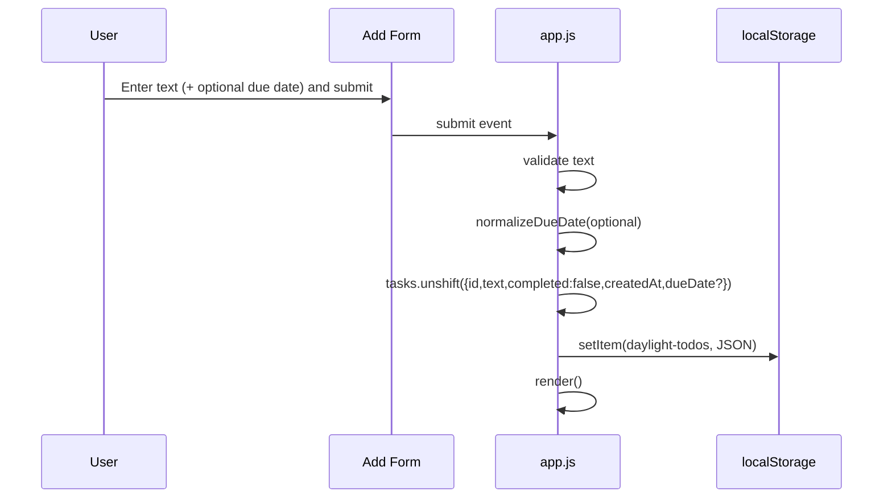
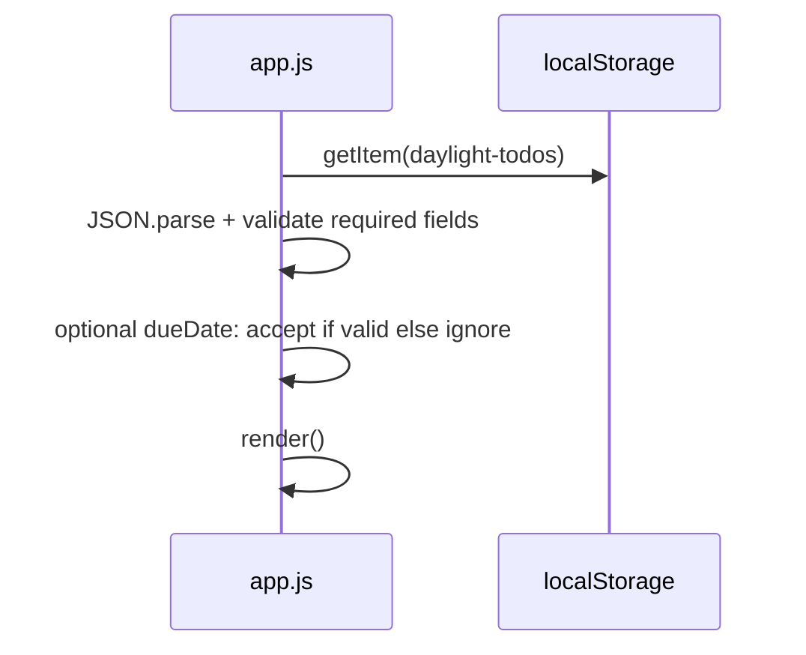

# High-Level Design (HLD) — EPMCDMETST-72039

**Document version:** 1.0  
**Date:** 2026-11-25  

## 1. System context
Daylight ToDo is a browser-only SPA. Users create tasks and the app persists them to `localStorage`. This change introduces an optional due date field and an overdue indicator.

### Context diagram (C4 level-1)
```mermaid
flowchart LR
  User[End User] -->|Interacts| SPA[Daylight ToDo SPA\n(index.html + app.js + styles.css)]
  SPA -->|Read/Write| LS[(Browser localStorage\nkey: daylight-todos)]
```

## 2. Major components
### 2.1 UI (index.html + styles.css)
- Add-form controls:
  - Task text input (existing)
  - Due date input (new, optional)
- Task list item visual structure:
  - Toggle button (existing)
  - Task text (existing)
  - Due date label (new, conditional)
  - Overdue badge/state styling (new, conditional)
  - Delete button (existing)

### 2.2 Application logic (app.js)
- **State:** `tasks`, `activeFilter`
- **Persistence:** `loadTasks()`, `saveAndRender()`
- **Rendering:** `render()`, `createTaskElement(task)`
- **New helper responsibilities (proposed identifiers):**
  - `normalizeDueDate(input: string) -> string | null` (validate `YYYY-MM-DD`)
  - `formatDueDate(yyyyMmDd: string) -> string` (DD MMM YYYY)
  - `getTodayLocalYmd() -> string` (YYYY-MM-DD)
  - `isTaskOverdue(task, todayYmd) -> boolean`

## 3. Component interactions
### 3.1 Add task


### 3.2 Load on startup


### 3.3 Render a task item
```mermaid
flowchart TD
  T[Task object] --> OD{Has valid dueDate?}
  OD -- No --> UI1[Render base task item\n(toggle + text + delete)]
  OD -- Yes --> FMT[formatDueDate -> DD MMM YYYY]
  FMT --> OV{isTaskOverdue?\n(dueDate < today && !completed)}
  OV -- No --> UI2[Render base + due date]
  OV -- Yes --> UI3[Render base + due date\n+ overdue badge/state]
```

## 4. Data flow
### 4.1 Persisted schema (to-be)
Stored under the same array key `daylight-todos`:
```json
{
  "id": "string",
  "text": "string",
  "completed": true,
  "createdAt": 1732550400000,
  "dueDate": "2027-01-05" 
}
```
Notes:
- `dueDate` is optional.
- Older tasks without `dueDate` remain valid.

### 4.2 Overdue computation
- Use **local date-only**.
- Proposed algorithm:
  - `todayYmd = getTodayLocalYmd()`
  - overdue iff `task.dueDate < todayYmd && task.completed === false`

## 5. Integration boundaries
- No server boundary.
- Only boundary is between app.js and browser APIs:
  - `localStorage`
  - DOM
  - (optional) `crypto.randomUUID`

## 6. Quality attributes (NFR coverage)
- **Local date correctness:** date-only logic; avoid UTC conversions.
- **Accessibility:** overdue indicator not color-only; ensure readable text and ARIA.
- **Performance:** O(n) per render remains; helpers are constant-time.
- **Resilience:** tolerate malformed stored dueDate by ignoring it.
